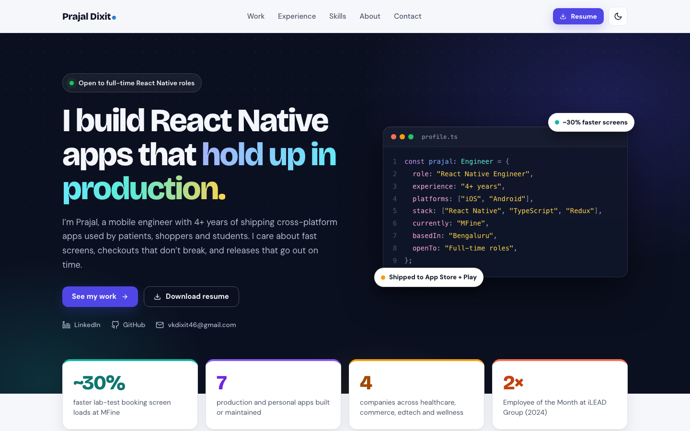

# Prajal Dixit · Portfolio

Personal site of Prajal Dixit, a React Native engineer in Bengaluru with 4+ years shipping iOS and Android apps across healthcare, commerce, edtech and wellness.

**Live:** https://prajaldixit.github.io/Portfolio/



## Stack

- React 17 (Create React App), no UI framework; hand-written CSS with light and dark themes
- Sections: hero + profile card, impact numbers, filterable work with case studies, experience, toolbox, how I work, about, FAQ, contact form
- Theme follows the visitor's system setting until they toggle it
- The contact form opens a pre-filled email (the site is static, no backend)
- To add a headshot, put it in `public/` and set `profile.photo` in `src/data/content.js`
- `react-icons` for icons
- Deployed to GitHub Pages with `gh-pages`

## Structure

```
src/
  data/content.js   all copy: profile, projects, experience, skills, FAQ, links
  sections/         one component per page section
  hooks/useReveal.js  scroll-in animation
  App.js            theme, scroll progress, case-study modal
public/
  Prajal_Dixit_Resume.pdf
  og-image.png      1200×630 link preview for LinkedIn, WhatsApp, etc.
```

## Run locally

```bash
npm ci
npm start        # http://localhost:3000/Portfolio
npm test
npm run deploy   # builds and publishes to GitHub Pages
```

## Contact

[LinkedIn](https://www.linkedin.com/in/prajaldixit/) · vkdixit46@gmail.com
